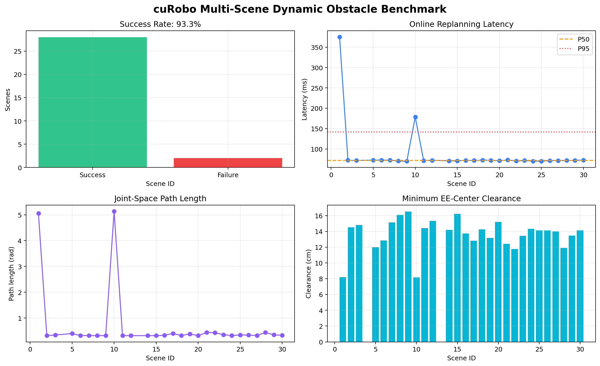

# GPU 加速机械臂运动规划与动态避障

## 1. 项目概述

本项目面向 Franka Panda 七自由度机械臂，完成从 GPU 运动规划、碰撞检测、轨迹生成，到 MuJoCo 离屏仿真可视化和 ROS 2 / MoveIt2 CPU 基线对比的完整流程。

项目不是单纯播放预设关节轨迹，而是实际调用 cuRobo 在 RTX 4090 上求解逆运动学、碰撞约束和时间参数化轨迹；当新障碍进入原路径后，系统会检查当前姿态，更新碰撞世界，并在线生成新的无碰轨迹。

核心演示流程：

    初始环境与目标位姿
            ↓
    cuRobo GPU 生成原始轨迹
            ↓
    执行到 5% 时出现动态障碍
            ↓
    自动验证当前姿态无碰撞、未来路径被阻挡
            ↓
    cuRobo 在线重新规划
            ↓
    MuJoCo 执行新轨迹并生成视频和指标

## 2. 已完成的功能

- Franka Panda URDF 模型加载与关节映射。
- cuRobo CUDA 扩展编译和 RTX 4090 GPU 验证。
- 目标位姿逆运动学与 GPU 轨迹生成。
- MuJoCo EGL 无显示器离屏渲染。
- 静态障碍环境中的碰撞感知规划。
- 动态障碍进入后的在线碰撞世界更新与重新规划。
- 候选障碍位置自动筛选，避免当前姿态与新障碍重叠。
- cuRobo 与 MoveIt2 OMPL RRTConnect 的重复实验对比。
- CSV、JSON、PNG、MP4 实验产物自动导出。

## 3. 技术栈

| 模块 | 技术 | 作用 |
|---|---|---|
| GPU 计算 | NVIDIA RTX 4090、CUDA 12.4 | 并行 IK、碰撞检测和轨迹优化 |
| 深度学习运行时 | PyTorch 2.4.0+cu124 | CUDA 张量和 cuRobo 扩展运行时 |
| 运动规划 | cuRobo 0.7.8 | GPU 加速 IK、轨迹优化和碰撞感知规划 |
| GPU 内核 | Warp 1.7.2 | cuRobo 几何与优化内核 |
| 仿真与渲染 | MuJoCo 3.2.7、EGL | 机械臂轨迹回放和离屏视频生成 |
| 机器人中间件 | ROS 2 Humble | Topic、TF、控制器和机器人软件接口 |
| CPU 基线 | MoveIt2、OMPL RRTConnect | 与 cuRobo 进行规划性能对比 |
| 控制框架 | ros2_control | Panda 模拟关节轨迹控制器 |
| 容器 | Apptainer、Ubuntu 22.04 | 隔离 ROS 2 与宿主机环境 |
| 作业调度 | Slurm | 申请和隔离 GPU 资源 |
| 可视化 | MuJoCo、Matplotlib、Foxglove | 视频、曲线和 ROS 数据展示 |

## 4. 项目目录

    robot_motion_control/
    ├── container/                         # Ubuntu 22.04 + ROS 2 Humble
    ├── third_party/curobo/                # cuRobo 0.7.8 源码
    ├── ros2_ws/src/planner_benchmark/     # MoveIt2 OMPL 基线
    ├── experiments/
    │   ├── panda_curobo_mujoco.py         # 基础 GPU 规划与渲染
    │   ├── curobo_benchmark.py            # cuRobo 重复实验
    │   ├── curobo_obstacle_visualization.py
    │   ├── curobo_dynamic_replanning.py  # 动态障碍在线重规划
    │   └── results/                       # 视频、图片、CSV 和 JSON
    ├── run_demo.sh
    ├── run_planner_comparison.sh
    ├── run_obstacle_visualization.sh
    ├── run_dynamic_replanning.sh
    └── PROJECT_WALKTHROUGH.md

## 5. 环境说明

GPU 任务需要通过 Slurm 获取显卡。推荐直接用 srun 包裹脚本，这样脚本结束后资源自动释放。

检查 GPU：

    srun --gpus=1 nvidia-smi

Python 环境：

    /data/yezhengfu/robot_motion_control/.venv-curobo

ROS 2、MoveIt2 和 Foxglove 位于 Apptainer 容器：

    /data/yezhengfu/robot_motion_control/container/rootfs/ubuntu22

## 6. 一键复现实验

所有命令均从服务器宿主机执行。

### 6.1 基础 cuRobo + MuJoCo 演示

    srun --gpus=1 bash -lc 'cd /data/yezhengfu/robot_motion_control && bash run_demo.sh'

输出包括 Panda 运动视频、轨迹 CSV、关节曲线和规划指标。

### 6.2 cuRobo 与 OMPL 对比

    srun --gpus=1 bash -lc 'cd /data/yezhengfu/robot_motion_control && bash run_planner_comparison.sh'

该脚本分别运行 cuRobo GPU 规划和 MoveIt2 OMPL CPU 规划，并生成统一对比图和报告。

### 6.3 静态障碍可视化

    srun --gpus=1 bash -lc 'cd /data/yezhengfu/robot_motion_control && bash run_obstacle_visualization.sh'

该脚本在固定障碍环境中规划碰撞自由轨迹，并生成 MuJoCo 视频。

### 6.4 动态障碍在线重规划

    srun --gpus=1 bash -lc 'cd /data/yezhengfu/robot_motion_control && bash run_dynamic_replanning.sh'

动态重规划脚本执行以下步骤：

1. 在静态桌面场景中生成初始轨迹。
2. 在轨迹执行到 5% 时加入动态障碍。
3. 在多个未来路径位置和障碍尺寸中自动筛选候选。
4. 候选必须保证当前机械臂姿态有效，同时让原未来路径发生碰撞。
5. 更新 cuRobo 碰撞世界并重新规划到同一目标。
6. 输出重新规划轨迹、避障距离、视频和指标。

## 7. 实验结果

### 7.1 cuRobo 与 OMPL 重复实验

| 指标 | cuRobo GPU | MoveIt2 OMPL CPU |
|---|---:|---:|
| 实验次数 | 20 | 20 |
| 成功率 | 100% | 100% |
| P50 规划延迟 | 34.391 ms | 42.486 ms |
| P95 规划延迟 | 37.528 ms | 56.277 ms |
| 平均关节路径长度 | 0.7144 rad | 2.5865 rad |
| 平均轨迹时间 | 1.2200 s | 1.5435 s |

在当前任务上，cuRobo 的 P50 规划延迟相对 OMPL 提升约 1.24 倍，同时生成了更短的关节空间路径。这个结果只代表当前硬件、场景和参数，不能直接推广到所有任务。

### 7.2 动态障碍在线重规划

| 指标 | 最终结果 |
|---|---:|
| 初始规划延迟 | 140.192 ms |
| 在线重规划延迟 | 73.568 ms |
| 初始与重规划轨迹点数 | 62 / 62 |
| 障碍进入时刻 | 原轨迹 5% |
| 障碍所在位置 | 原路径 54.1% |
| 实际障碍尺寸 | 0.035 × 0.035 × 0.060 m |
| 原路径最小末端中心距离 | 0.0000 m |
| 新路径最小末端中心距离 | 0.1238 m |
| 避障间距增益 | 0.1238 m |
| 结果 | 成功 |

原路径距离为 0，说明障碍确实进入了原路径；重规划后距离增至 12.38 cm，说明新轨迹绕开了障碍，而不是简单继续播放原轨迹。

## 8. 关键输出文件

- experiments/results/curobo_dynamic_replanning.mp4：动态检测、重规划和执行视频。
- experiments/results/curobo_dynamic_replanning.png：动态重规划海报帧。
- experiments/results/curobo_dynamic_replanning_metrics.json：最终指标。
- experiments/results/curobo_dynamic_replanning_trajectory.csv：前后轨迹拼接数据。
- experiments/results/planner_comparison.png：cuRobo 与 OMPL 对比图。
- experiments/results/PLANNER_COMPARISON.md：规划器对比报告。
- experiments/results/panda_curobo_demo.mp4：基础 GPU 规划演示。

## 9. 动态重规划实现要点

### 9.1 为什么不能直接把障碍放到未来路径点

机械臂末端的未来位置与当前其他连杆可能重叠。如果直接放置障碍，cuRobo 会判断当前起点已经处于世界碰撞状态，并返回 INVALID_START_STATE_WORLD_COLLISION。

最终实现会自动遍历不同路径比例和障碍尺寸，并调用起点有效性检查：

- 当前执行姿态必须无碰撞。
- 对应的未来原轨迹姿态必须发生碰撞。
- 只有同时满足两项的候选才会用于在线重规划。

这使实验从手工调参变为可重复的自动场景构造。

### 9.2 为什么使用已知终点

初始规划成功后，程序使用原轨迹终点的真实关节状态计算目标末端位姿。该位姿已知可达，可减少动态重规划阶段随机 IK 失败。

### 9.3 可视化与真实碰撞尺寸

视频中的实心红色几何体使用实际碰撞尺寸。额外的半透明红色光圈只用于突出小型动态障碍，不参与规划，也不修改实验指标。

## 10. ROS 2 与真机迁移

迁移到实验室真实机械臂时，不是只替换一个模型文件，也不需要从零开始。可以复用规划、评测和数据导出框架，但必须完成：

1. 获取机械臂准确型号、URDF/Xacro、关节名称和关节限位。
2. 创建对应的 cuRobo robot YAML 和碰撞球模型。
3. 配置 MoveIt2 SRDF、规划组、末端执行器和控制器。
4. 将规划轨迹映射为 ROS 2 FollowJointTrajectory 接口。
5. 标定基座、相机和工作空间坐标系。
6. 加入速度、加速度、急停、工作空间和碰撞安全限制。
7. 先在仿真和低速模式验证，再连接真实硬件。

当前 Panda 接口可作为统一模板。如果实验室机械臂同样提供 ROS 2 驱动和轨迹控制器，主要工作是模型、控制器、坐标系和安全参数适配，而不是重写规划器。

## 11. 已知限制

- 当前动态障碍由程序直接注入，并非来自真实相机或点云。
- 实验场景数量仍较少，对比结果需要增加多目标、多障碍任务。
- MuJoCo 当前用于轨迹回放和视觉验证，不代表完整电机动力学控制器。
- 末端中心距离是直观展示指标；严格安全评估仍应使用全机械臂碰撞距离。
- 真机部署前必须加入轨迹限速、急停和控制周期验证。

## 12. 下一步扩展建议

1. 建立 20 至 50 个不同目标和障碍布局的批量 benchmark。
2. 增加成功率、规划时间、路径长度、最小安全距离和平滑度统计。
3. 接入深度相机或点云，将感知结果更新到 cuRobo 碰撞世界。
4. 通过 ROS 2 action 将 cuRobo 轨迹发送给 ros2_control。
5. 选择实验室具体机械臂，完成模型和控制器适配。
6. 增加抓取任务或具身智能策略作为上层决策模块。

## 13. 简历表述

项目名称：GPU 加速机械臂运动规划与动态避障系统

建议写法：

- 基于 cuRobo、CUDA 和 PyTorch 构建 Franka Panda GPU 运动规划系统，完成逆运动学、碰撞检测、轨迹优化及 MuJoCo EGL 离屏仿真闭环。
- 实现动态障碍在线更新与自动有效性筛选，在 RTX 4090 上实现 73.6 ms 在线重规划，并将原碰撞路径的末端中心避障距离由 0 提升至 12.38 cm。
- 搭建 MoveIt2 OMPL RRTConnect CPU 基线，在 20 次同任务实验中实现 100% 成功率，cuRobo P50 延迟为 34.4 ms，并自动导出对比图、轨迹和实验报告。
- 使用 Apptainer 隔离 ROS 2 Humble / MoveIt2 环境，结合 Slurm 管理 GPU 资源，形成可复现的一键实验脚本。

不要写成已经部署到真实机械臂；当前准确表述是 GPU 规划、ROS 2 接口验证和 MuJoCo 仿真。完成真机实验后再补充硬件部署经历。

## 14. 实现原理与验证

### 项目解决了什么问题

传统 CPU 采样规划在复杂碰撞场景中延迟和路径质量不稳定。本项目使用 GPU 并行 IK、碰撞检测和轨迹优化，提高在线规划速度，并实现环境变化后的重新规划。

### 最难的问题是什么

动态障碍可能不仅挡住未来末端路径，还会碰到当前机械臂的其他连杆，导致重规划起点无效。解决方法是构造候选障碍集合，自动检查当前状态和未来状态，选择满足“当前安全、未来受阻”的候选。

### 如何证明真的发生了避障

程序记录障碍与末端路径的最小中心距离：原路径为 0，新路径为 0.1238 m；同时保存前后轨迹 CSV 和动态视频。

### GPU 在哪里发挥作用

cuRobo 将大量 IK 种子、机器人碰撞球查询和轨迹优化计算放在 CUDA 上并行执行。MuJoCo 主要负责轨迹回放和渲染，不是本项目 GPU 规划性能的来源。

## 15. 常见问题

### CUDA 不可用

确认命令运行在 Slurm GPU 作业中，并检查 CUDA_VISIBLE_DEVICES 和 nvidia-smi。

### Warp 提示驱动版本不足

本项目固定使用 Warp 1.7.2。不要升级到要求更高驱动版本的 Warp 1.19。

### MuJoCo 出现 duplicate geom name 警告

这是 URDF 中多个几何体没有唯一名称，MuJoCo 会自动创建匿名名称。当前不影响模型加载、轨迹回放和规划结果。

### cuRobo 返回 INVALID_START_STATE_WORLD_COLLISION

表示重规划起点和新世界中的障碍发生碰撞。动态脚本已经通过候选筛选规避该问题。

### cuRobo 返回 IK_FAIL

检查目标是否可达、目标姿态是否与障碍碰撞，并增加 IK/规划尝试次数。动态脚本使用已知可达的原轨迹终点作为重规划目标。

## 16. 当前完成状态

- [x] ROS 2 Humble、MoveIt2、Panda 配置。
- [x] Panda mock controller 和 MoveGroup 接口验证。
- [x] Foxglove ROS 数据可视化。
- [x] cuRobo CUDA 扩展和 RTX 4090 验证。
- [x] 基础 GPU 轨迹规划。
- [x] MuJoCo EGL 视频生成。
- [x] cuRobo 与 OMPL 重复实验对比。
- [x] 静态障碍碰撞感知规划。
- [x] 动态障碍在线重规划。
- [x] 自动候选障碍有效性筛选。
- [x] 实验结果、视频和指标导出。
- [x] 30 场景动态障碍批量 benchmark。
- [ ] 真实传感器输入。
- [ ] 实验室真实机械臂部署。

## 17. 多场景动态障碍 Benchmark

为了避免单场景演示的偶然性，项目使用固定随机种子 20261123 生成 30 个不同目标位置，并为每个目标自动构造动态障碍。

每个场景都先生成原始轨迹，再搜索一个同时满足以下条件的障碍：

- 当前执行姿态保持无碰撞。
- 原轨迹的未来姿态被障碍阻挡。
- 障碍尺寸和所在路径比例被记录到 CSV。

### 17.1 最终汇总

| 指标 | 结果 |
|---|---:|
| 场景数 | 30 |
| 成功场景 | 28 |
| 成功率 | 93.33% |
| 在线重规划平均延迟 | 86.1213 ms |
| 在线重规划 P50 | 71.6174 ms |
| 在线重规划 P95 | 141.5773 ms |
| 平均关节路径长度 | 0.6870 rad |
| 平均轨迹时间 | 1.4979 s |
| 平均最小末端中心距离 | 0.1362 m |
| 最差成功场景安全距离 | 0.0818 m |

### 17.2 失败场景分析

- 场景 4：NO_VALID_BLOCKER。当前候选集合内没有找到既不碰撞当前机械臂、又能阻挡未来轨迹的障碍，因此场景构造被安全拒绝。
- 场景 13：IK_FAIL。在动态碰撞约束和配置的搜索预算内，IK/轨迹规划没有收敛，系统将其保留为真实失败样本。

没有删除这两个失败场景，因为 93.33% 的真实成功率和明确的失败分类，比只报告筛选后的成功案例更可信。

### 17.3 延迟离群点

大多数成功场景的在线重规划时间约为 70–73 ms。场景 1 为 375.55 ms，场景 10 为 178.63 ms，说明部分目标会触发更重的图搜索、种子重置或优化过程。P50 与 P95 同时报告，避免只用平均值掩盖长尾延迟。

### 17.4 新增简历表述

- 构建 30 场景确定性动态障碍 benchmark，实现 93.3% 在线重规划成功率；RTX 4090 上重规划 P50 为 71.6 ms、P95 为 141.6 ms，28 个成功场景的最差末端中心避障距离为 8.18 cm。

详细产物：

- experiments/results/multiscene_runs.csv
- experiments/results/multiscene_summary.json
- experiments/results/multiscene_benchmark.png
- experiments/results/MULTISCENE_BENCHMARK.md

至此，项目已经形成可运行、可展示、可量化并可写入简历的第一版完整闭环。
