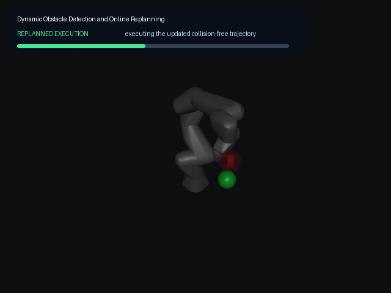
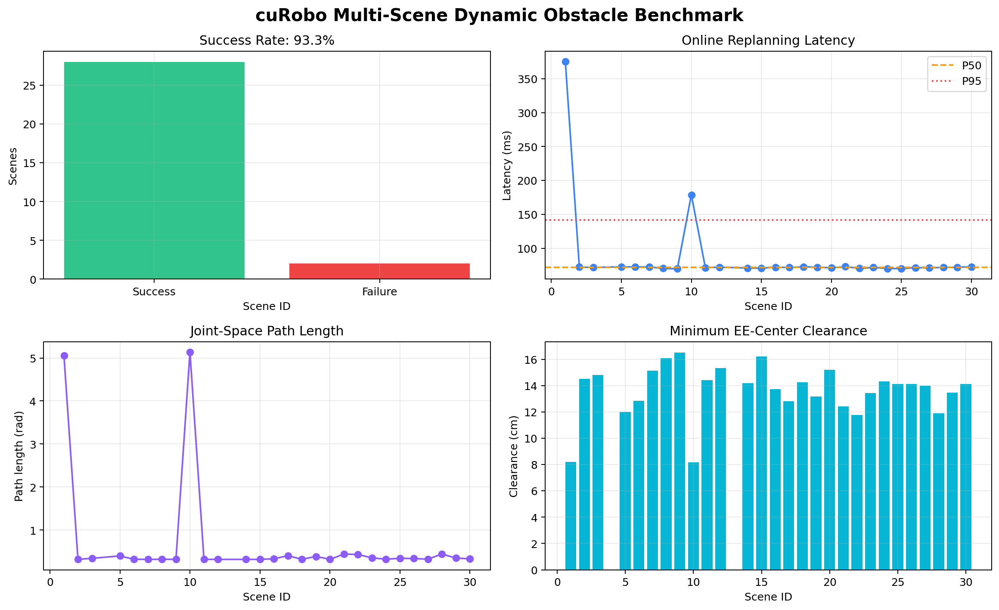
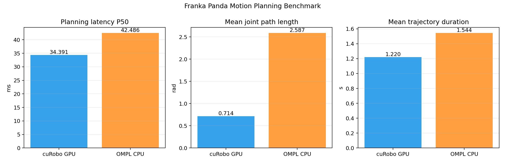
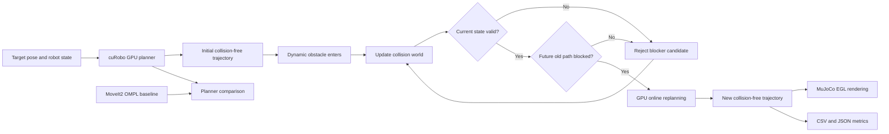

# GPU-Accelerated Robot Motion Planning

A reproducible motion-planning and dynamic-replanning project for the Franka Panda robot, built with **cuRobo, CUDA, PyTorch, MuJoCo, ROS 2 Humble, MoveIt2, and OMPL**.

The project runs GPU collision-aware trajectory generation on an RTX 4090, injects an obstacle into the robot's future path, validates that the current state remains safe, and generates a new collision-free trajectory online.

> 中文简介：这是一个面向机械臂运动规划实习岗位的完整项目，包含 GPU 轨迹优化、动态障碍重规划、MuJoCo 可视化、MoveIt2/OMPL 基线对比、30 场景批量实验和可复现报告。

## Highlights

- CUDA-accelerated IK, collision checking, and trajectory optimization with cuRobo 0.7.8.
- Dynamic collision-world updates and online replanning.
- Automatic blocker validation: current state safe, future path invalidated.
- MuJoCo EGL rendering for headless servers.
- ROS 2 Humble, MoveIt2, OMPL RRTConnect, and ros2_control baseline.
- Deterministic 30-scene benchmark with CSV, JSON, plots, and Markdown reports.
- Apptainer isolation and Slurm GPU scheduling.

## Demo



[Watch the dynamic replanning video](experiments/results/curobo_dynamic_replanning.mp4)

The red solid geometry is the real collision obstacle. A translucent red halo is added only for visibility and does not affect planning or metrics.

## Results

### Multi-scene dynamic replanning

Thirty deterministic target and obstacle scenes were generated with random seed 20261123.

| Metric | Result |
|---|---:|
| Successful scenes | 28 / 30 |
| Success rate | **93.33%** |
| Replanning latency mean | 86.12 ms |
| Replanning latency P50 | **71.62 ms** |
| Replanning latency P95 | 141.58 ms |
| Mean joint-space path length | 0.6870 rad |
| Mean trajectory duration | 1.4979 s |
| Mean minimum EE-center clearance | 13.62 cm |
| Worst successful-scene clearance | **8.18 cm** |



The two failures are intentionally retained:

- One scene could not construct a blocker that was safe for the current state while invalidating the future path.
- One scene failed collision-constrained IK within the configured search budget.

This preserves the real 93.33% success rate instead of filtering the dataset to report an artificial 100%.

### cuRobo GPU vs. MoveIt2 OMPL CPU

Both planners used the same Panda start configuration and target pose for 20 trials.

| Metric | cuRobo GPU | OMPL RRTConnect CPU |
|---|---:|---:|
| Success rate | 100% | 100% |
| Planning latency P50 | **34.391 ms** | 42.486 ms |
| Planning latency P95 | **37.528 ms** | 56.277 ms |
| Mean joint path length | **0.7144 rad** | 2.5865 rad |
| Mean trajectory duration | **1.2200 s** | 1.5435 s |



These numbers describe this hardware, task, and parameter set; they are not claimed as universal planner performance.

### Single dynamic obstacle run

| Metric | Result |
|---|---:|
| Initial planning latency | 140.192 ms |
| Online replanning latency | **73.568 ms** |
| Obstacle position | 54.1% of the original path |
| Real obstacle size | 3.5 × 3.5 × 6.0 cm |
| Original-path EE-center distance | 0.0 cm |
| Replanned-path EE-center distance | **12.38 cm** |

A zero original-path distance verifies that the obstacle actually blocks the old path. The replanned trajectory increases the measured distance to 12.38 cm.

## System Architecture



## Repository Layout

```text
robot_motion_control/
├── container/
│   ├── definition/                  # Apptainer definition files
│   └── tools/
├── ros2_ws/src/planner_benchmark/   # MoveIt2 OMPL baseline
├── experiments/
│   ├── panda_curobo_mujoco.py
│   ├── curobo_benchmark.py
│   ├── curobo_obstacle_visualization.py
│   ├── curobo_dynamic_replanning.py
│   ├── curobo_multiscene_benchmark.py
│   └── results/                     # Curated reproducibility artifacts
├── run_demo.sh
├── run_planner_comparison.sh
├── run_obstacle_visualization.sh
├── run_dynamic_replanning.sh
├── run_multiscene_benchmark.sh
├── setup_curobo_source.sh
└── PROJECT_WALKTHROUGH.md           # Detailed Chinese walkthrough
```

Large generated environments are intentionally excluded:

- Python virtual environments
- Apptainer rootfs
- downloaded cuRobo source
- ROS build/install/log directories
- intermediate videos and temporary results

## Environment

The validated environment is:

| Component | Version |
|---|---|
| Operating system | Ubuntu 22.04 |
| GPU | NVIDIA GeForce RTX 4090, 24 GB |
| Driver / CUDA runtime | 550.90.07 / CUDA 12.4 |
| Python | 3.10 |
| PyTorch | 2.4.0+cu124 |
| cuRobo | 0.7.8 |
| Warp | 1.7.2 |
| MuJoCo | 3.2.7 |
| ROS 2 | Humble |
| MoveIt2 | Humble packages |
| Container runtime | Apptainer 1.4.2 |

Warp is pinned to 1.7.2 because newer releases may require a newer NVIDIA driver.

## Setup

### 1. Create the Python environment

```bash
python3 -m venv .venv-curobo
source .venv-curobo/bin/activate
python -m pip install --upgrade pip
```

Install the CUDA 12.4 PyTorch build:

```bash
python -m pip install   --index-url https://download.pytorch.org/whl/cu124   torch==2.4.0 torchvision==0.19.0 torchaudio==2.4.0
```

Install the tested simulation dependencies:

```bash
python -m pip install   warp-lang==1.7.2   mujoco==3.2.7   matplotlib   imageio   imageio-ffmpeg
```

### 2. Download and install cuRobo

The setup script downloads the pinned cuRobo 0.7.8 source archive:

```bash
bash setup_curobo_source.sh
```

Then install it as an editable package:

```bash
export CUDA_HOME=/usr/local/cuda
export TORCH_CUDA_ARCH_LIST=8.9
export MAX_JOBS=8

python -m pip install   -e third_party/curobo   --no-build-isolation
```

Verify the GPU and compiled extensions before running experiments.

### 3. ROS 2 / MoveIt2 baseline

ROS 2 Humble and MoveIt2 are isolated in the Apptainer Ubuntu 22.04 environment. The large writable rootfs is not committed. Rebuild it from the files under container/definition or adapt the scripts to an existing ROS 2 Humble installation.

## Run

On a Slurm-managed GPU server, replace PROJECT_ROOT with the repository path.

### Basic GPU planning and MuJoCo rendering

```bash
srun --gpus=1 bash -lc 'cd PROJECT_ROOT && bash run_demo.sh'
```

### cuRobo vs. MoveIt2 OMPL comparison

```bash
srun --gpus=1 bash -lc 'cd PROJECT_ROOT && bash run_planner_comparison.sh'
```

### Static obstacle visualization

```bash
srun --gpus=1 bash -lc 'cd PROJECT_ROOT && bash run_obstacle_visualization.sh'
```

### Dynamic obstacle online replanning

```bash
srun --gpus=1 bash -lc 'cd PROJECT_ROOT && bash run_dynamic_replanning.sh'
```

### Thirty-scene benchmark

```bash
srun --gpus=1 bash -lc 'cd PROJECT_ROOT && bash run_multiscene_benchmark.sh'
```

The benchmark uses a fixed seed, continues after individual scene failures, and writes:

- experiments/results/multiscene_runs.csv
- experiments/results/multiscene_summary.json
- experiments/results/multiscene_benchmark.png
- experiments/results/MULTISCENE_BENCHMARK.md

## Dynamic Replanning Logic

A naive implementation can place an obstacle on a future end-effector point while accidentally colliding with another link at the current robot state. cuRobo correctly rejects this as INVALID_START_STATE_WORLD_COLLISION.

The implemented scene generator searches candidate path fractions and obstacle sizes. A candidate is accepted only when:

1. the current execution state is valid in the updated world;
2. a later state on the original path is invalid;
3. the obstacle and selected path fraction are recorded for reproducibility.

The replanning goal is computed from the known reachable terminal joint configuration of the original successful trajectory. This reduces random IK failure without hiding collision constraints.

## ROS 2 and Real-Robot Path

The planning and benchmark framework can be reused for a real robot, but deployment is not a one-file model swap. It requires:

1. the vendor URDF/Xacro, joint limits, and collision geometry;
2. a matching cuRobo robot YAML and collision-sphere model;
3. MoveIt2 SRDF and planning-group configuration;
4. a ROS 2 FollowJointTrajectory-compatible controller;
5. base, camera, and workspace calibration;
6. velocity, acceleration, workspace, collision, and emergency-stop limits;
7. simulation and low-speed validation before normal operation.

The current repository is accurately described as GPU planning, ROS 2 interface validation, and MuJoCo simulation—not real-hardware deployment.

## Artifacts

| Artifact | Description |
|---|---|
| [Dynamic replanning video](experiments/results/curobo_dynamic_replanning.mp4) | Detect–replan–execute sequence |
| [Dynamic metrics](experiments/results/curobo_dynamic_replanning_metrics.json) | Single-scene quantitative result |
| [Multi-scene report](experiments/results/MULTISCENE_BENCHMARK.md) | 30-scene aggregate analysis |
| [Multi-scene raw runs](experiments/results/multiscene_runs.csv) | Per-scene data |
| [Planner comparison report](experiments/results/PLANNER_COMPARISON.md) | cuRobo vs. OMPL |
| [Detailed walkthrough](PROJECT_WALKTHROUGH.md) | Chinese implementation and interview guide |

## Limitations

- Dynamic obstacles are injected programmatically rather than reconstructed from a live depth camera.
- EE-center distance is an interpretable visualization metric; full safety assessment must use whole-robot collision distance.
- MuJoCo is currently used for trajectory playback and rendering, not a tuned low-level torque controller.
- The benchmark covers 30 deterministic scenes on one robot and one GPU.
- Real-robot safety and controller validation remain future work.

## Next Steps

- Depth-camera or point-cloud updates to the cuRobo world.
- ROS 2 action bridge from cuRobo trajectories to ros2_control.
- Multi-obstacle and moving-obstacle benchmarks.
- Real robot model and controller adaptation.
- Task-level grasping or embodied-agent integration.

## Safety

All current execution is simulation-only. Real-robot deployment requires the vendor driver, accurate robot and collision models, calibration, conservative limits, emergency-stop procedures, and low-speed validation.

## References

- [NVIDIA cuRobo](https://github.com/NVlabs/curobo)
- [ROS 2 Control](https://github.com/ros-controls/ros2_control)
- [MuJoCo](https://github.com/google-deepmind/mujoco)
- [MoveIt 2](https://github.com/moveit/moveit2)
