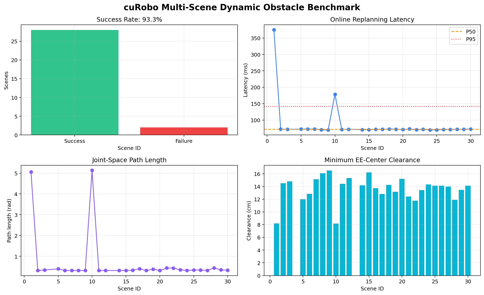

# cuRobo Multi-Scene Benchmark

## Configuration

- Robot: Franka Panda
- Planner: cuRobo 0.7.8
- GPU: NVIDIA GeForce RTX 4090
- Deterministic random seed: 20261123
- Requested scenes: 30
- Each scene: a reachable target candidate plus an automatically validated dynamic blocker

## Aggregate Results

| Metric | Result |
|---|---:|
| Successful scenes | 28 / 30 |
| Success rate | 93.33% |
| Replanning latency mean | 86.121 ms |
| Replanning latency P50 | 71.617 ms |
| Replanning latency P95 | 141.577 ms |
| Mean joint path length | 0.6870 rad |
| Mean trajectory duration | 1.4979 s |
| Mean minimum EE-center clearance | 0.1362 m |
| Worst successful-scene clearance | 0.0818 m |

Failed status counts: NO_VALID_BLOCKER: 1, REPLAN_MotionGenStatus.IK_FAIL: 1

## Interpretation

The benchmark changes the Cartesian target and constructs a collision obstacle on the original future path for every scene. A blocker is accepted only when the current execution state remains valid and a later original-trajectory state becomes invalid. Therefore, successful replanning results represent actual online path replacement rather than replay of an unchanged trajectory.

