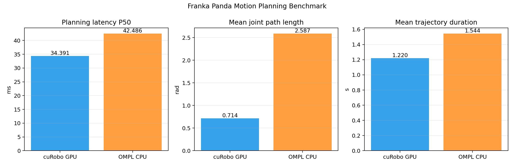

# Planner Comparison

## Experiment

- Robot: Franka Panda
- Task: identical start configuration and goal pose
- Trials: cuRobo 20, OMPL 20
- GPU: NVIDIA GeForce RTX 4090
- Planners: cuRobo 0.7.8 and MoveIt2 OMPL RRTConnect

## Results

| Metric | cuRobo GPU | OMPL CPU |
|---|---:|---:|
| Success rate | 100.0% | 100.0% |
| Planning latency P50 | 34.391 ms | 42.486 ms |
| Planning latency P95 | 37.528 ms | 56.277 ms |
| Mean joint path length | 0.7144 rad | 2.5865 rad |
| Mean trajectory duration | 1.2200 s | 1.5435 s |

## Conclusion

cuRobo achieved a P50 planning-latency speedup of **1.24x** over OMPL on this task.

